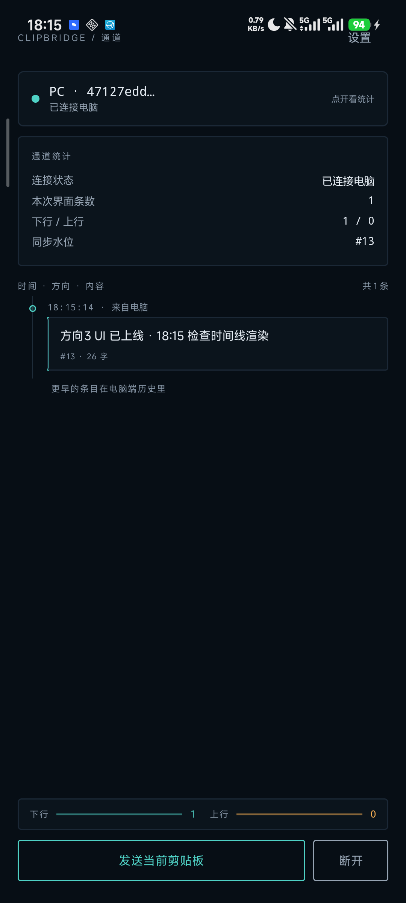
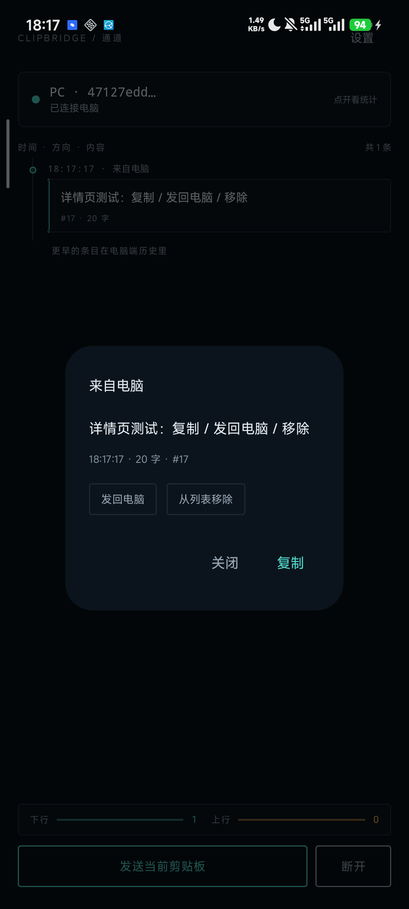

# ClipBridge

Windows ↔ Android 的剪贴板 / 文本同步工具。传输走 [iroh](https://iroh.computer)（QUIC + NAT 打洞 + 官方 relay），
**不经过任何 IM、不依赖厂商推送、不落公有云中转**。

- 电脑上复制 → 手机通知栏出现，点「复制」直接进手机剪贴板
- 手机上长按桌面图标 / 分享面板 / 快捷设置磁贴 → 一段文本进电脑剪贴板
- 两端都常驻，断线 3 秒重连，错过的条目按 `seq` 补发

<p align="center">
  
</p>

## 为什么不用现成方案

| 现成做法 | 问题 |
|---|---|
| 微信/QQ 文件传输助手 | 要开 IM、要手动点、文本还得自己复制 |
| 各类「扫码传文件」网页 | 必须同一 WiFi 或走第三方服务器，隐私不可控 |
| 厂商推送 + 云中转 | 需要企业资质，且文本会过第三方 |

ClipBridge 的取舍：**服务器架在 Windows 上，手机主动拨号**，官方 relay 只做发现与打洞失败时的兜底通道。

## 当前状态

| 能力 | 状态 |
|---|---|
| 文本双向同步、离线补发、多设备广播 | ✅ 真机验证 |
| Windows 常驻：托盘、`Ctrl+Alt+H` 全局热键、历史窗口（搜索/复制/删除/清空）、开机自启 | ✅ |
| 手机常驻前台服务（`specialUse`，MIN 通知），断线自动重连 | ✅ |
| 收到文本只发 LOW 通知，不自动写剪贴板；打开 app 不自动上传剪贴板 | ✅ |
| 桌面图标长按 / 分享面板 / 快捷设置磁贴 三个发送入口 | ✅ |
| 手机端界面（设计稿方向 3「一条通道」） | ✅ |
| 文件传输：Windows 端收发（`.part` + SHA256 校验 + 同名不覆盖 + ≤2GB 校验）+ `send-file` 命令 | ✅ |
| 文件传输：PC → 手机（`outbox/` 投递即推，手机落盘 + 校验回包 + 进度/完成通知） | ✅ |
| 手机端断线探测（20s 心跳探活，半开连接能自己发现并重连） | ✅ |
| 文件传输：手机 → PC、暂停/恢复/取消 UI | ⬜ 进行中 |
| 图片剪贴板 | ⬜ |
| 手机端历史持久化 / 多台电脑配对 | ⬜ |
| Windows 历史窗口自绘（当前仍是原生 EDIT/LISTBOX） | ⬜ |

<p align="center">
  
</p>

## 架构

```
Android (SyncService + Rust core .so)  ──iroh/QUIC──►  Windows (clipbridge.exe serve)
        │  主动拨号，长连接常驻                          │  监听 + 托盘 + 剪贴板轮询 + 历史
        └─ 收到推送 → LOW 通知 → 用户点「复制」          └─ 复制 → 入队(seq) → 广播所有在线设备
```

- **控制面**：一条常驻双向流，帧格式 `[type u8][len u32 LE][payload]`
- **发现**：`presets::N0`，只凭 `EndpointId` 就能连（relay 区域会变，不写死）
- **不丢**：Windows 端每条文本落 `store/items/<seq>.txt`，手机 `HELLO` 带 `last_seq` 触发补发
- **不回推**：历史窗口「复制」写入剪贴板时用 `SELF_WRITE_HASH` 抑制，避免把自己发回手机

完整设计（需求矩阵、协议表、文件传输状态机、风险清单）见 [`docs/architecture.md`](docs/architecture.md)；
UI 三方向初稿与落地选择见 [`design/design-demos/`](design/design-demos/)。

## 目录

```
core/          Rust lib：端点身份、协议帧、peer 解析
windows/       Rust bin：clipbridge.exe（listen / 剪贴板 / 队列 / 托盘 / 历史窗口）
android/       Kotlin app（top.ieop.clipbridge）+ Compose 界面
android/jni/   Rust cdylib：JNI 桥，产出 libclipbridge_android.so
design/        UI 方向稿（HTML 展示板 + 说明）
docs/          架构文档、截图
```

## 构建

### Windows

```powershell
cargo build --release -p clipbridge
# 产物：target/release/clipbridge.exe（单文件，无运行时依赖）
.\target\release\clipbridge.exe serve --dir D:\ClipBridge
```

`serve` 会在 `HKCU\Software\Microsoft\Windows\CurrentVersion\Run` 登记开机自启，托盘里可关；
`clipbridge autostart --off` 可手动关闭。

### Android

`.so` 不入库，需先编（arm64 为真机必需）：

```powershell
cargo ndk -t arm64-v8a -o android/app/src/main/jniLibs build -p clipbridge-android --release
cd android
.\gradlew.bat assembleDebug        # 产物 app/build/outputs/apk/debug/app-debug.apk
```

`build.gradle.kts` 里的 `DEFAULT_PEER_ID` 是打包时烧进 APK 的电脑端 ID（自己用就填自己的）：

```powershell
.\gradlew.bat assembleDebug -Pclipbridge.peer=<电脑端 ID>
```

Gradle 不读 Windows 系统代理，走代理时在 `android/gradle.properties` 里加
`systemProp.https.proxyHost=127.0.0.1` / `systemProp.https.proxyPort=7900`。

## 使用

1. 电脑端 `clipbridge info` 拿到 `ID`
2. 手机装 APK，在「设置」里填这个 ID（打包时已内置则跳过），Relay 留空即可
3. 电脑上复制文本 → 手机通知栏「来自电脑的文本」，点「复制」
4. 手机发文本：长按桌面图标选「发送剪贴板」、任意 app 里分享、或下拉点磁贴
5. 电脑端 `Ctrl+Alt+H` 打开历史窗口

发文件（两个方向都已可用）：

```powershell
# 电脑 → 手机：把文件丢进 outbox，serve 会推给所有在线手机
copy D:\path\to\big.zip D:\ClipBridge\outbox\
# 成功后自动移到 outbox\sent\；失败留在原地，每 2s 重试并从 .part 断点续传

# 电脑 → 电脑（手机主动拨号，所以不能用 send-file 直接打给手机）
clipbridge.exe send-file --peer <对方 ID> --file D:\path\to\big.zip
# 对方落盘到 <dir>\inbox\，SHA256 校验通过后才改名，同名自动加 " (1)"
```

手机收到的文件在 app 私有目录 `files/inbox/`（要放进系统相册/下载需手动分享）。

## 已知限制

- Android 10+ 后台读不到剪贴板，所以手机侧只能由用户动作触发（设计如此，不是缺陷）
- 国产 ROM 可能杀后台，需要在系统里给「无省电限制 / 自启动」白名单
- 单条文本超过 64KB 不采集（控制面不塞大 payload）
- 未做额外鉴权：能连上就信任（`EndpointId` 即身份，白名单待做）

## 开发

```powershell
cargo test                                  # core
cargo run -p clipbridge -- recv --peer <ID> # 模拟手机端，看广播与补发
```

提交约定：一个功能一个 commit，信息写清「做了什么 + 为什么」；不改用户数据目录里的内容。

## 路线图

- [x] M1 文本双向 + Windows 常驻界面
- [x] 手机端方向 3 界面 + 内置配对 ID
- [x] M2 文件双向传输（`FILE_OFFER/PAUSE/RESUME/CANCEL`，`.part` 落盘，≤2GB）
  - [x] core：报价/接受/完成 payload、`.part` 落盘、SHA256、同名去重、CHUNK 流式、稳定传输 id（重试续传）
  - [x] Windows：接收（`inbox/` 落盘）+ `clipbridge send-file` + `outbox/` 投递即推
  - [x] Android：JNI 回调 + 后台落盘 + 进度/完成通知 + 校验回包
  - [ ] Android：手机 → PC 发文件、暂停/取消 UI
- [ ] M3 图片剪贴板（DIB → PNG，缩略图通知）
- [ ] M4 手机端历史持久化、多台电脑配对
- [ ] M5 Windows 历史窗口自绘，与手机端同一套视觉

## License

MIT
